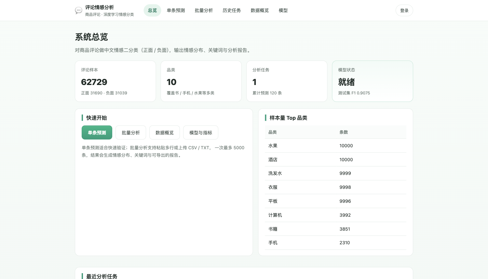
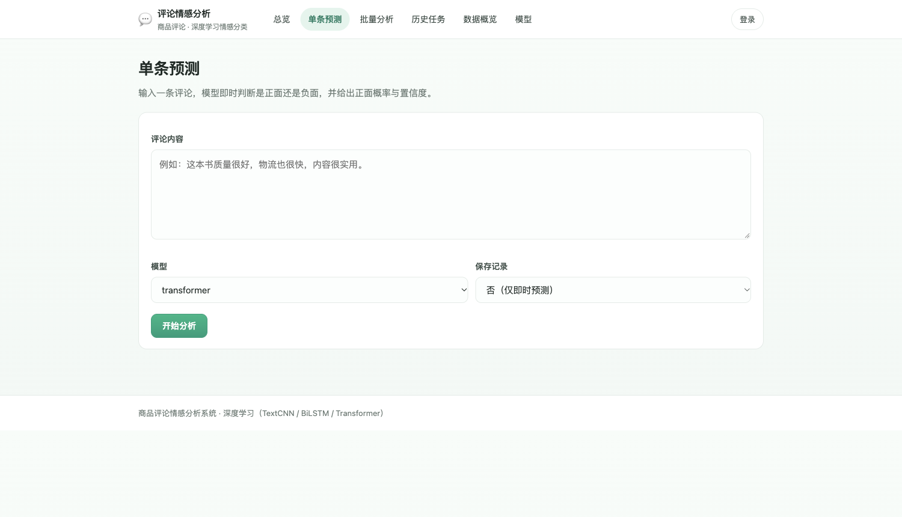
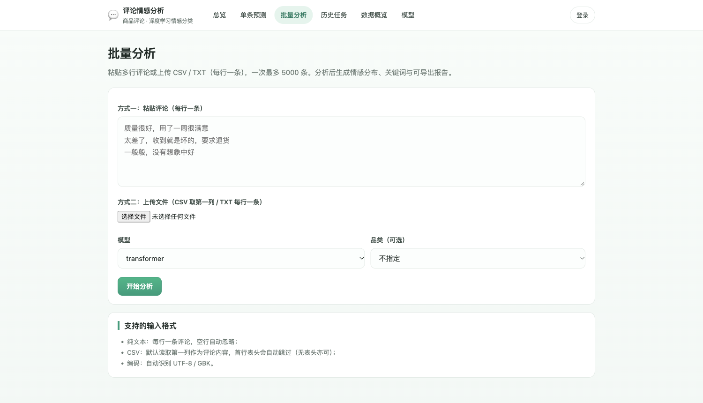
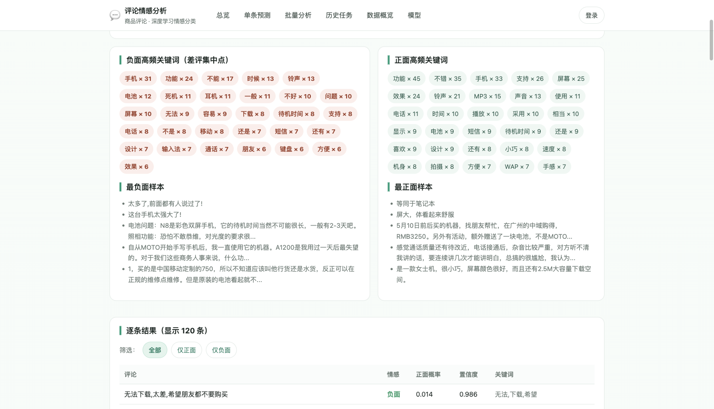
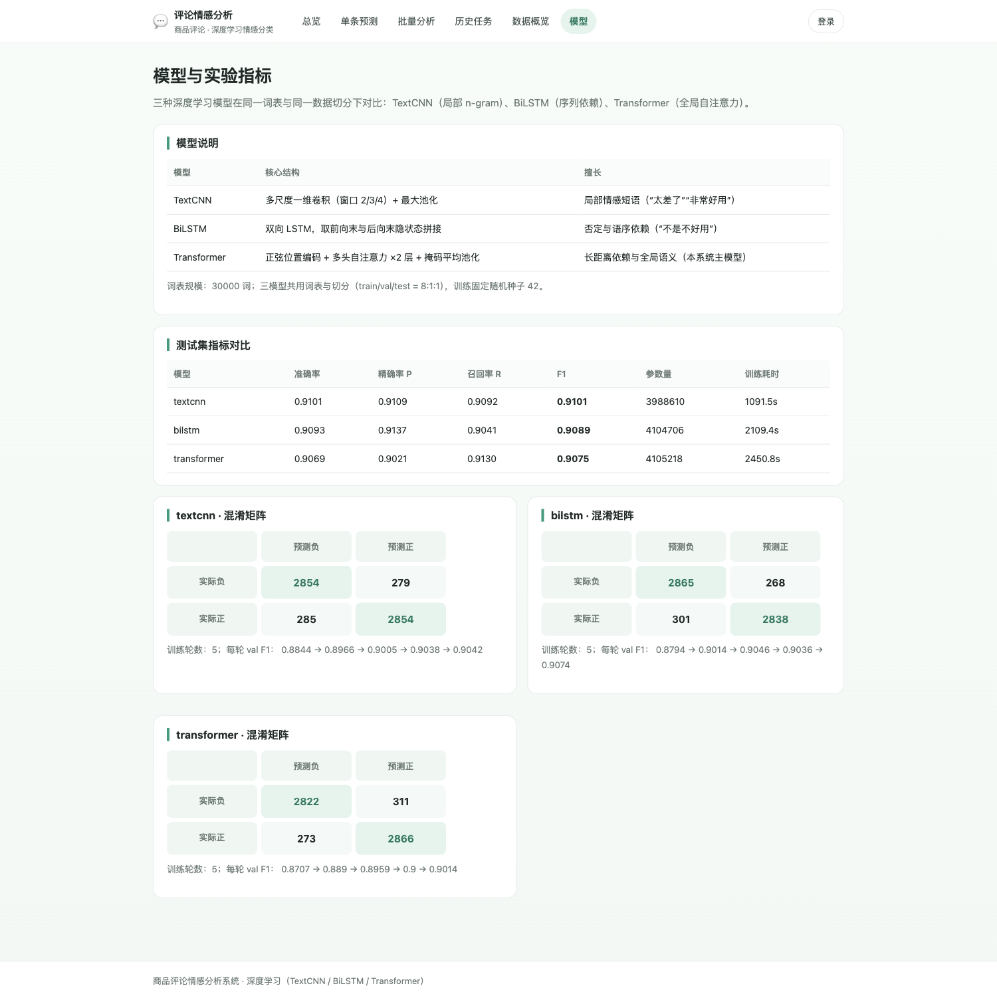
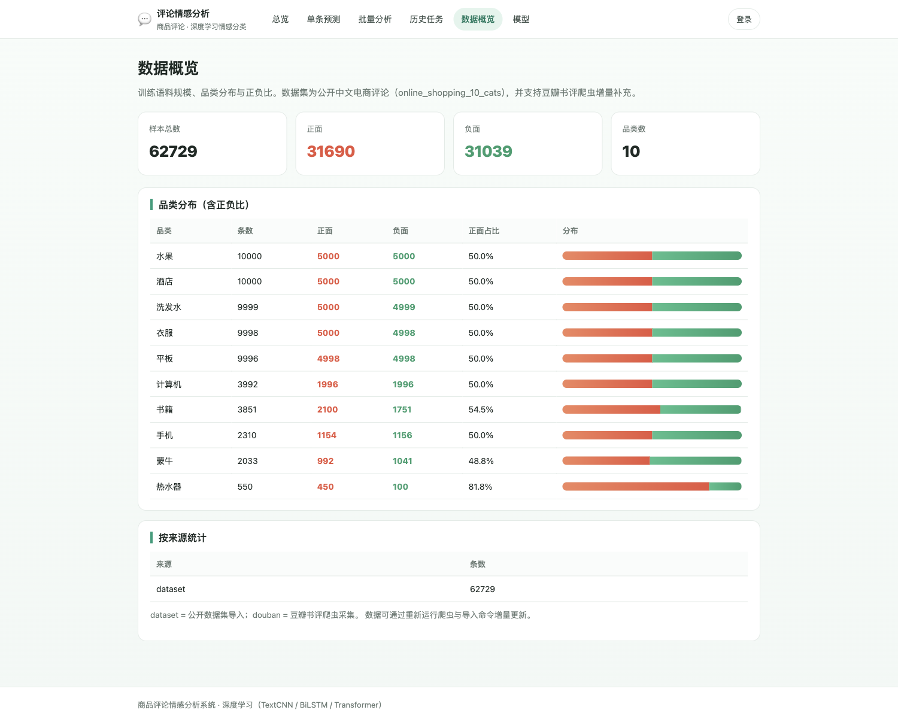

# 028 基于深度学习的商品评论情感分析系统-设计展示

> **代码有偿获取 可接受定制 微信联系方式: csbysj2020 或 ACE2487，备注(BS)**

> **完整源码与全套文档 · 在线自助获取 >>> [https://mbd.pub/o/bread/YZaWlpdybA==](https://mbd.pub/o/bread/YZaWlpdybA==)**

> **成品页（功能介绍 / 更多选题）>>> [https://bishe.suilang.net/products/comment-sentiment](https://bishe.suilang.net/products/comment-sentiment)**

> 

> 

## 视频

> **点击查看 >>> [https://www.bilibili.com/video/BV1AXWT6WE88/](https://www.bilibili.com/video/BV1AXWT6WE88/)**

## 项目简介

面向商品评论的中文情感分析系统：对评论做正面/负面二分类，支持单条预测、批量分析、情感分布与关键词、报告导出。三种深度学习模型（TextCNN / BiLSTM / Transformer）在同一词表与同一数据切分下公平对比，测试集 F1 分别为 0.9101 / 0.9089 / 0.9075。关键结论是：在本任务规模下模型复杂度并未带来收益，而不同模型的误差结构不同——Transformer 偏激进（漏报少）、BiLSTM 偏保守（误报少），应按「更怕漏报还是更怕误报」来选型。

商品评论是消费者决策与商家改进的重要依据，但随着评论量增长，人工阅读难以覆盖，平台给出的「好评率」也无法回答「差评到底在说什么」。

本项目设计并实现了一套基于深度学习的商品评论情感分析系统，把「单条情感判断」扩展为可批量、可解释的经营分析链路。

数据方面，本项目采用公开中文电商评论数据集 online_shopping_10_cats（62,729 条，10 个品类，正负标注），并实现豆瓣书评爬虫作为可实时更新的补充数据源。

本仓库为**设计展示**：包含项目说明、技术架构、实验结果与运行截图；完整源码、任务书、开题报告、毕业论文与使用说明可通过上方链接自助获取，成品页可查看更多选题，也可联系微信咨询定制。

## 功能特性

1. 三种模型公平对比：TextCNN / BiLSTM / Transformer 共用同一词表（30000 词）与同一数据切分（8:1:1，固定种子 42），指标可直接横向比较

2. 一个反直觉的发现：三者测试集 F1 差距不足 0.003（0.9101 / 0.9089 / 0.9075），说明本任务规模下模型复杂度未带来收益；论文 6.4 节完整分析了三个原因

3. 误差结构差异：Transformer 召回率最高（0.9130）而精确率最低（0.9021），偏激进；BiLSTM 相反（0.9137 / 0.9041），偏保守。选型应看「更怕漏报还是误报」

4. 困难样本实测：反讽与转折样本准确率仅 60%（常规样本 90.7%），逐条列出失败原因（反讽、转折结构、弱表达三类）

5. 数据来源真实可核：实测京东（Request Forbidden）/ 淘宝（风控页）/ 苏宁（空返回）评论接口均不可抓，改用公开数据集 6.2 万条 + 豆瓣书评爬虫双轨方案

6. 内置可用的豆瓣爬虫：抓取短评按星级映射情感标签，可随时增量更新数据，解决「数据能不能更新」的常见疑问

7. 训练与推理共用同一套预处理：所有清洗与分词集中在 preprocess.py，从根本上避免「离线指标好、线上效果差」的口径错位

8. 关键词双语义：既给出单条评论的特征词，也按情感分组聚合为「差评集中点」（如电池、死机、耳机），把 30% 差评细化为具体问题

9. 完整 Web 系统：单条预测（异步接口）、批量分析（粘贴/上传，自动识别编码，上限 5000 条）、报告导出 CSV（带 BOM，Excel 不乱码）、历史任务、数据概览、模型页

10. 论文记录了一个真实 bug 的定位与修复：空样本导致整行 padding，Transformer 注意力 softmax 产生 NaN、loss 直接变 NaN，修复后同批数据 5000 条 F1 达 0.9168

## 技术架构

| 项目 | 说明 |
| --- | --- |
| 编程语言 | Python 3.8 |
| 深度学习框架 | PyTorch 2.2.2（CPU 训练与推理，无需显卡） |
| 模型结构 | TextCNN（多尺度卷积）/ BiLSTM（双向循环）/ Transformer（2 层自注意力） |
| 分词与评测 | jieba 0.42、scikit-learn 1.3（P/R/F1 与混淆矩阵） |
| Web 框架 | Django 4.2 |
| 数据库 | SQLite 默认（5 张表，可切 MySQL） |
| 数据规模 | 62,729 条中文电商评论（正面 31,690 / 负面 31,039），10 个品类 |
| 性能参考 | 批量 5000 条约数秒；单条预测毫秒级；训练（CPU）TextCNN 约 18 分钟 / BiLSTM 约 35 分钟 / Transformer 约 41 分钟 |
| 启动方式 | 双击启动脚本，或 python3 manage.py runserver |

## 目录结构

以下为完整交付版的结构（本仓库仅作设计展示）：

```
comment-sentiment/
├── 任务书/
│   └── 毕业设计任务书.docx
├── 开题报告/
│   └── 毕业设计开题报告.docx
├── 最终论文/
│   ├── 图/
│   │   ├── 图3-1_各品类样本分布.png
│   │   ├── 图4-1_系统架构图.png
│   │   ├── 图6-1_训练收敛曲线.png
│   │   ├── 图6-2_训练损失曲线.png
│   │   ├── 图6-3_模型指标对比.png
│   │   ├── 图6-4_混淆矩阵.png
│   │   ├── 图6-5_参数量与耗时.png
│   │   └── 图6-6_困难样本性能退化.png
│   └── 基于深度学习的商品评论情感分析系统设计.docx
├── 源码/
│   ├── crawler/
│   │   ├── __init__.py
│   │   └── douban_review.py
│   ├── data/
│   │   └── online_shopping_10_cats.csv
│   ├── model/
│   │   ├── architectures.py
│   │   ├── bilstm.pt
│   │   ├── data.py
│   │   ├── metrics.json
│   │   ├── textcnn.pt
│   │   ├── train.py
│   │   ├── transformer.pt
│   │   └── vocab.json
│   ├── sentiment/
│   │   ├── management/
│   │   ├── migrations/
│   │   ├── __init__.py
│   │   ├── admin.py
│   │   ├── apps.py
│   │   ├── engine.py
│   │   ├── models.py
│   │   ├── preprocess.py
│   │   ├── services.py
│   │   ├── urls.py
│   │   └── views.py
│   └── …
└── …
```

## 数据与实验结论

- 测试集结果显示，三者性能高度接近：TextCNN 的 F1 为 0.9101、BiLSTM 为 0.9089、Transformer 为 0.9075，最大差距不足 0.003。
- 这一结果本身构成了本项目的一个重要发现：在本任务的语料规模下，模型结构的复杂度并未带来相应的收益，约 400 万参数的三者在常规样本上的判别能力已趋于饱和。
- 进一步的困难样本测试表明，反讽与隐晦表达上的准确率仅约 60%，暴露出模型在语用层面理解的不足。

## 交付内容

1. 完整源码（Django 工程、三种模型定义、词表与数据管道、中文预处理、豆瓣爬虫、Web 页面）
2. 训练好的三套模型权重（textcnn.pt / bilstm.pt / transformer.pt，各约 15~）
3. 训练数据 62,729 条（online_shopping_10_cats.csv，随包提供，开箱即可训练，无需联网）
4. 训练与评测脚本（固定随机种子，输出 P/R/F1 与混淆矩阵）
5. 评测指标文件 metrics.json（页面的模型页直接读取，非手填）
6. 豆瓣书评爬虫（可现场演示「数据可更新」）
7. 毕业设计任务书（Word）、开题报告（Word）
8. 毕业论文（Word，七章制，含三模型对比、误差结构分析、困难样本逐条分析）
9. 系统使用与二次开发说明（Word + md）
10. 运行截图 6 张 + 功能演示视频（91 秒，带中文旁白）

## 常见问题

**数据是爬的吗？能更新吗？**

采用「公开数据集 + 爬虫」双轨。训练语料是公开数据集 online_shopping_10_cats（6.2 万条中文电商评论，10 个品类，正负标注）；同时内置了真实可用的豆瓣书评爬虫（crawler/douban_review.py），运行一条命令即可抓取新数据并导入，用于演示「数据可实时更新」。

**为什么不用京东/淘宝的评论数据？**

因为已经抓不动了。开发时逐个实测：京东评论接口返回 Request Forbidden（带 Referer 也被拒）、淘宝 rate 接口返回风控跳转页、苏宁接口空返回、小红书与微博搜索 302 跳登录。这是平台风控所致，不是代码问题。论文 3.4 节完整记录了实测过程与结论。同类系统声称「爬取电商评论」的多已失效，本项目如实说明边界。

**三个模型哪个最好？**

在测试集上 F1 分别是 TextCNN 0.9101、BiLSTM 0.9089、Transformer 0.9075，差距不足 0.003——可以说打平。更重要的是误差结构不同：Transformer 漏报最少（召回 0.9130）但误报最多，适合「差评预警」这种怕漏的场景；BiLSTM 精确率最高（0.9137）但漏报多，适合「筛好评做展示」这种怕误伤的场景。选型看用途，不是看谁 F1 高一点。

**为什么说模型复杂度没带来收益？**

这是本项目一个明确发现。三者参数量都在 400 万左右，Transformer 的 F1 反而最低。论文 6.4 节给了三个原因：一是电商评论情感表达直白、关键词信号强，任务本身可分性高；二是评论平均仅 58 字，Transformer 擅长的长距离依赖用不上；三是数据中存在标注边界模糊的样本，构成了性能共同上限。并且 Transformer 训练最慢（CPU 41 分钟 vs TextCNN 18 分钟），在本部署条件下 TextCNN 反而是性价比最高的选择。

**反讽和隐晦表达识别得怎么样？**

不理想。构造的 10 条反讽/转折样本上准确率只有 60%，明显低于常规测试集的 90.7%。失败案例包括「还行吧，凑合用」（被高置信度判为正面）和「东西是可以的，就是物流有点慢」（被后半句负面词带偏）。论文 6.5 节逐条分析了三类失败原因，核心是模型依赖词汇级情感信号、缺乏语用与篇章结构的理解。

**论文里那个 NaN 的 bug 是什么？**

是空样本导致的。数据里有「很好非常好，」这类样本，分词后被停用词和标点全部过滤，编码得到整行 padding；Transformer 在全 padding 上做注意力 softmax 会产生 NaN，反向传播后污染整个 batch，表现为 loss 直接变 NaN、F1 恒为 0。修复分两处：编码时保证至少一个占位符，模型前向对全 padding 行强制解 mask。这个 bug 有普遍性，论文 5.1 节完整记录了定位过程。

## 截图







